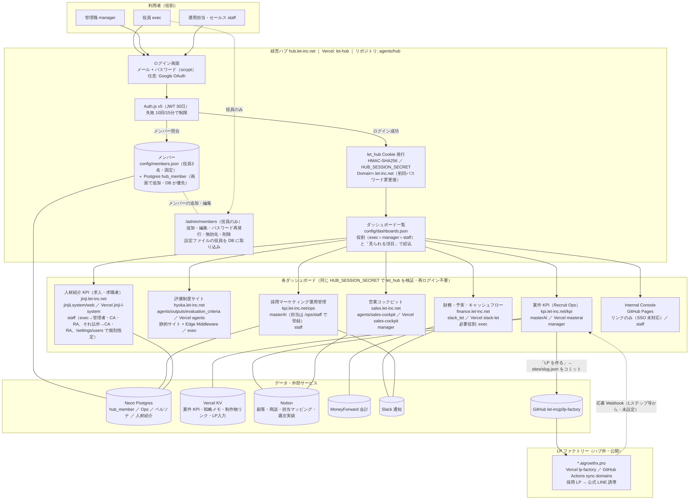
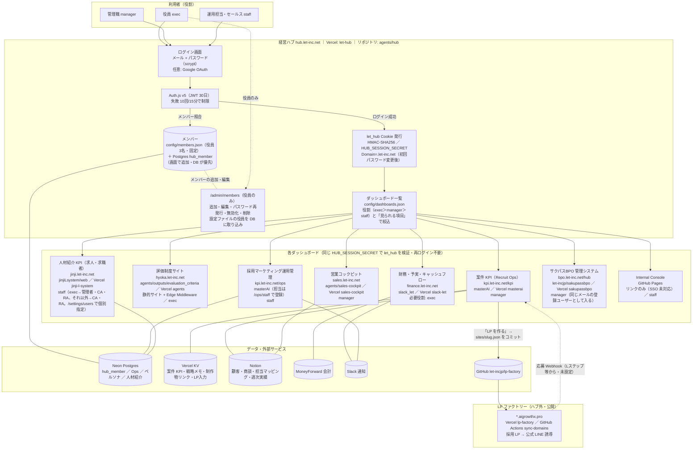

# 経営ハブ 構成図（2026-10-22 時点）

経営ハブ（`hub.let-inc.net`）を入口に、共通 Cookie `let_hub` で各ダッシュボードへ再ログインなしで移動する構成。図は Mermaid（GitHub 上でそのまま描画される）。

## 全体図

同じ図の Mermaid ソース（GitHub 上で描画される）:

## 構成要素の一覧

| 要素 | URL | リポジトリ ／ Vercel | 認証 | データ | 必要役割 |
|---|---|---|---|---|---|
| 経営ハブ | hub.let-inc.net | agents/hub ／ let-hub | Auth.js（メール+パスワード、任意で Google）→ `let_hub` 発行 | config/members.json ＋ Postgres hub_member | 全員 |
| 財務・予実・CF | finance.let-inc.net | slack_let ／ slack-let | `let_hub`（exec） | MoneyForward・Notion・Slack | exec |
| 評価制度サイト | hyoka.let-inc.net | agents/outputs/evaluation_criteria ／ agents | Edge Middleware で `let_hub`（exec） | 静的 | exec |
| 営業コックピット | sales.let-inc.net | agents/sales-cockpit ／ sales-cockpit | `let_hub` | Notion | manager |
| 案件 KPI（Recruit Ops） | kpi.let-inc.net/kpi | masterAI ／ masterai | `let_hub` | Vercel KV・Notion | manager |
| 採用マーケ運用管理 | kpi.let-inc.net/ops | masterAI ／ masterai | `let_hub` ＋ /ops/staff | Postgres（Neon） | staff |
| 人材紹介 KPI | jinji.let-inc.net | jinjiLsystem/web ／ jinji-l-system | `let_hub`（staff 以上。`HUB_MIN_ROLE` で絞り込み可）＋ /settings/users | Postgres | staff |
| サクパスBPO 管理システム | bpo.let-inc.net | let-incjp/sakupassbpo ／ sakupassbpo | `let_hub`（`/hub` で同じメールの登録ユーザーのセッションを発行）＋通常ログイン（クライアント・ワーカー） | Postgres（Neon） | manager |
| Internal Console | GitHub Pages | agents/console | なし（リンクのみ） | 静的 | staff |
| LP ファクトリー（ハブ外） | *.aigrowthx.pro | let-incjp/lp-factory ／ lp-factory | なし（公開） | sites/*.json（masterAI「LP を作る」から生成） | — |

## 共通の仕組み

- **共通ログイン**: ハブでログイン → 初回パスワード変更後に `let_hub`（HMAC-SHA256、`HUB_SESSION_SECRET`、Domain `.let-inc.net`、payload は email/name/role/期限）を発行。各アプリは同じ秘密で検証するだけで、ユーザー DB を持たない
- **役割**: `exec` ＞ `manager` ＞ `staff`。ハブの「見られる項目」でさらに絞れる。人材紹介は staff 以上を通し、exec→管理者・CA・RA、それ以外→CA・RA を既定として `/settings/users` で個別指定。運用管理は `/ops/staff` の登録で担当者になる
- **メンバー管理**: `/admin/members`（役員のみ）。設定ファイルの役員 3 名は固定だが「編集できるようにする」で DB に取り込める（DB が優先）
- **秘密の所在**: `HUB_SESSION_SECRET`（ハブ＋7 プロジェクト共通。2026-10-23 に sakupassbpo を追加）、`HUB_PASSWORD_HASHES`（設定ファイル役員のパスワード）、`HUB_DATABASE_URL`（メンバー DB）。各アプリ固有: `CRON_SECRET`（slack-let / sales-cockpit）、`RECRUIT_INTAKE_KEY`・`LP_FACTORY_GITHUB_TOKEN`・`MK_AGENDA_TRIGGER_KEY`（masterai）、`VERCEL_TOKEN`（lp-factory の GitHub Secret）

## 関連ドキュメント

- 設計・計画: `docs/HUB_INTEGRATION_PLAN.md`
- 引き継ぎ: `docs/HUB_HANDOVER_2026-10-20.md`
- オーナー手順: `docs/OWNER_TASKS_2026-10-20.md`
- 実物確認チェックリスト: `docs/MARKETING_OPS_CHECKLIST_2026-10-21.md`
- ハブの実装: `hub/README.md`
